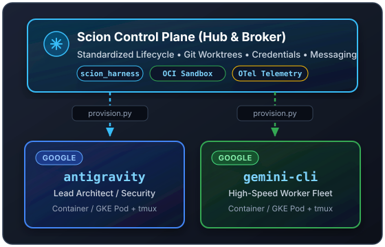
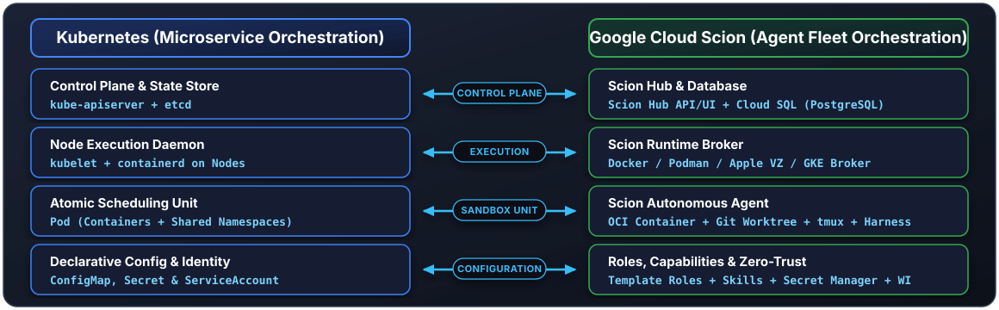
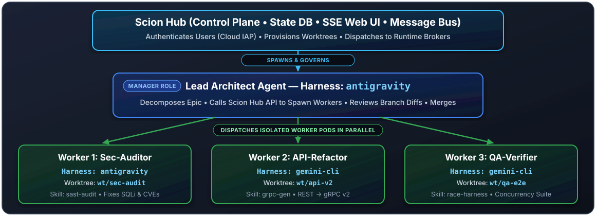
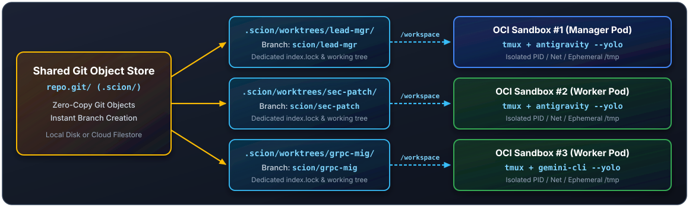
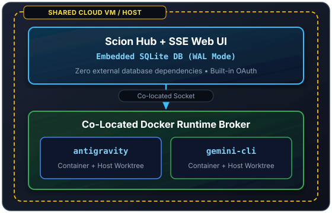
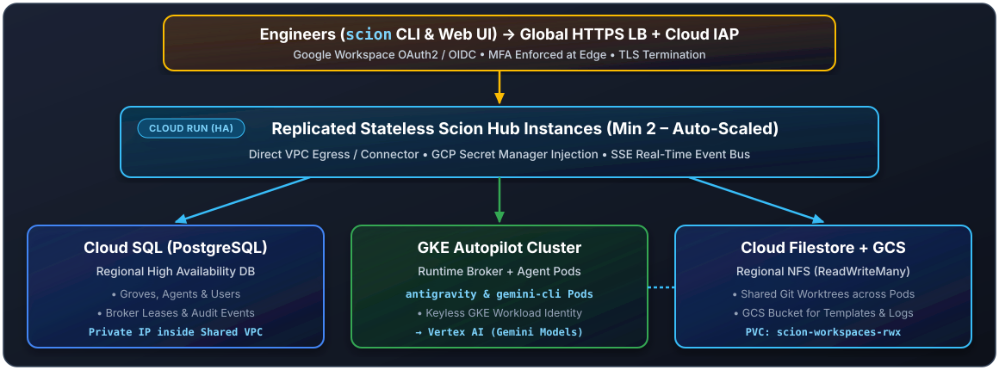
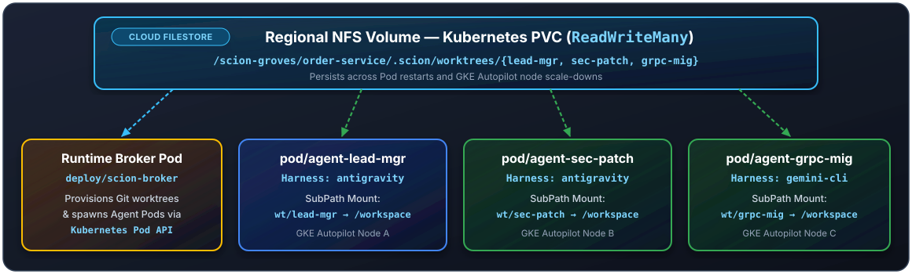
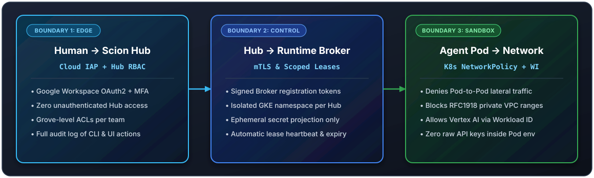

<!-- .slide: class="title-slide" data-background-gradient="radial-gradient(circle at 20% 20%, #172a4a 0%, #0b0f19 60%, #060911 100%)" -->

<div class="badge-row">
  <span class="badge badge-blue">Google Cloud Open Source</span>
  <span class="badge badge-green">Multi-Agent Orchestration</span>
  <span class="badge badge-amber">Docker &bull; GKE Autopilot &bull; GCP HA</span>
</div>

# Your LLMs work as a team, <span class="gradient-text">but who manages them?</span>

<p class="subtitle">Orchestrate the chaos with <strong>Google Cloud Scion</strong></p>

<div class="author-block">
  <span class="author-item"><strong>Repo:</strong> <a href="https://github.com/GoogleCloudPlatform/scion" target="_blank">github.com/GoogleCloudPlatform/scion</a></span>
  <span class="author-item">&bull;</span>
  <span class="author-item"><strong>Docs:</strong> <a href="https://googlecloudplatform.github.io/scion/overview/" target="_blank">googlecloudplatform.github.io/scion</a></span>
</div>

Note:
Welcome everyone! Over the next 45 minutes, we are going to tackle one of the biggest engineering challenges in GenAI today: moving from a fragile local script where two LLMs chat with each other, to an isolated, cloud-native fleet of autonomous coding agents managed by **Google Cloud Scion**.

--

## 45-Minute Session Roadmap

<p class="subtitle">From DIY Python scripts to a High Availability AI Fleet on Google Cloud</p>

<div class="grid-2">
  <div class="card card-blue">
    <h3>Part I: Architecture &amp; Foundations (~20m)</h3>
    <ol>
      <li><strong>The DIY Multi-Agent Trap</strong> (5 min)</li>
      <li><strong>Scion Philosophy:</strong> Why Scion Exists (5 min)</li>
      <li><strong>The 8 Core Concepts:</strong> Groves to Hubs (6 min)</li>
      <li><strong>Supported Harnesses &amp; Worktrees:</strong> <code>antigravity</code> &amp; <code>gemini-cli</code> (4 min)</li>
    </ol>
  </div>
  <div class="card card-green">
    <h3>Part II: Cloud Scale, Security &amp; Demo (~25m)</h3>
    <ol start="5">
      <li><strong>Choosing a Run Mode:</strong> Laptop to Cloud (4 min)</li>
      <li><strong>GCP High Availability Deep Dive:</strong> Terraform, Cloud Run, SQL, Filestore &amp; GKE (5 min)</li>
      <li><strong>Security &amp; Credential Injection:</strong> Vertex AI &amp; Secret Manager (4 min)</li>
      <li><strong>Live Demo:</strong> 4-Agent Task Force on GCP HA + Q&amp;A (12 min)</li>
    </ol>
  </div>
</div>

Note:
Here is our agenda for this 45-minute session.
In the first half, we'll dissect why DIY multi-agent scripts fail in production, explore Scion's Philosophy, walk through its 8 Core Concepts, and see how Scion wraps harnesses like `antigravity` and `gemini-cli` inside isolated Git worktrees and containers.
In the second half, we'll compare Scion's 3 Run Modes, dive deep into the Terraform-backed GCP High Availability architecture, examine security and credential injection, and run a multi-stage Live Demo on GCP HA.

---

## Part 1: The DIY Multi-Agent Trap

<p class="subtitle">"We've all written that cobbled-together Python script to get two LLMs to chat..."</p>

<div class="grid-2">
  <div class="card card-red">
    <h3>Day 1: Local Magic</h3>
    <ul>
      <li>100 lines of Python in a single notebook or script</li>
      <li>Two LLM prompts passing strings in a <code>while True</code> loop</li>
      <li>Executes generated bash commands via <code>subprocess.run(shell=True)</code></li>
      <li><strong>Result:</strong> Great 5-minute demo on your laptop!</li>
    </ul>
  </div>
  <div class="card card-amber">
    <h3>Day 2: Production Nightmare</h3>
    <ul>
      <li>What happens when <strong>4 agents edit the same repo</strong> simultaneously?</li>
      <li>What happens when an agent runs <code>rm -rf</code> or installs conflicting dependencies?</li>
      <li>Where do API keys and <code>~/.config/gcloud</code> tokens live?</li>
      <li>What happens when you close your laptop lid mid-task?</li>
    </ul>
  </div>
</div>

Note:
We have all been there. You write a quick script where a "Coder" LLM and a "Reviewer" LLM pass strings back and forth. Locally, with one agent, it feels like magic. The moment you try to run 4 coding agents in parallel on a real repository, everything catches fire.

--

## Anatomy of the Fragile DIY Script

```python
# The classic "weekend prototype" multi-agent loop
while not task_done:
    patch = coder_llm.chat(history)
    # 1. Overwrites the local working tree directly!
    open("service.py", "w").write(patch)

    # 2. Runs untrusted AI code on the host OS with host ENV!
    res = subprocess.run(
        "pytest && git commit -am 'wip'",
        shell=True, env=os.environ, capture_output=True
    )
    history.append(reviewer_llm.chat(res.stdout))
```

<div class="callout callout-danger">
  <strong>3 Critical Flaws in 12 Lines:</strong> Shared working directory, unrestricted host execution (<code>shell=True</code>), and full host environment variable leakage (<code>os.environ</code>).
</div>

Note:
Look closely at what this 12-line script actually does:
1. It writes directly to the local filesystem—if two agents run in parallel, they overwrite each other's files.
2. It runs `subprocess.run(..., shell=True)` directly on the host kernel.
3. It passes `env=os.environ`, exposing every credential on your workstation to dynamically generated code.

--

## The 4 Horsemen of Multi-Agent Chaos

<div class="grid-2">
  <div class="card card-red">
    <h3>1. Workspace Collisions</h3>
    <p>Parallel agents editing the same directory trigger <code>fatal: Unable to create '.git/index.lock': File exists</code> and corrupt each other's uncommitted diffs.</p>
  </div>
  <div class="card card-amber">
    <h3>2. Dependency &amp; Port Clashes</h3>
    <p>Agent A upgrades a library or binds <code>localhost:8080</code> for integration tests while Agent B runs a competing test suite on the same port.</p>
  </div>
  <div class="card card-blue">
    <h3>3. Credential Sprawl</h3>
    <p>Agents running on the host inherit <code>~/.ssh</code>, <code>~/.kube/config</code>, and <code>gcloud</code> application-default credentials with zero blast-radius control.</p>
  </div>
  <div class="card card-green">
    <h3>4. Zero Fleet Observability</h3>
    <p>No central state, no structured telemetry, no way to pause/interject into a stuck agent, and zero path from laptop to Kubernetes.</p>
  </div>
</div>

Note:
When you run parallel coding agents in the real world, you hit these four walls immediately:
1. `.git/index.lock` and file race conditions.
2. Port and dependency collisions.
3. Unbounded credential access on the host.
4. No way to observe, steer, or scale the fleet beyond your laptop.

--

## Paradigm Shift: Prompting &rarr; Architecture

<div class="arch-diagram">
  <div class="grid-2">
    <div class="arch-box" style="border-color: rgba(234,67,53,0.5);">
      <div class="arch-title" style="color: var(--gcp-red);">Yesterday: DIY Prompt Glue</div>
      <div class="arch-sub">
        Single Python Process &bull; Shared Folder<br>
        Prompt "Please don't break anything"<br>
        Hardcoded to 1 Model SDK &bull; Laptop-bound
      </div>
    </div>
    <div class="arch-box arch-hub">
      <div class="arch-title">Today: Distributed Systems Architecture</div>
      <div class="arch-sub">
        Control Plane (Hub) + Execution Plane (Brokers)<br>
        Dedicated Git Worktrees + OCI Sandboxes<br>
        Harness-Agnostic &bull; Laptop to GKE Autopilot
      </div>
    </div>
  </div>
</div>

<div class="callout callout-info">
  <strong>Key Insight:</strong> Managing a team of autonomous coding agents is not a prompt engineering problem—it is a <strong>distributed systems &amp; container orchestration problem</strong>.
</div>

Note:
This is the core thesis of our talk: orchestrating a team of LLMs that write, compile, test, and commit code is no longer a prompt-engineering problem. It is a distributed systems and container orchestration problem.

---

## Part 2: Scion Philosophy — Why Scion Exists

<p class="subtitle">The Orchestration Testbed for Multi-Agent Systems (<a href="https://googlecloudplatform.github.io/scion/philosophy/" target="_blank">scion/philosophy</a>)</p>

<div class="callout callout-info">
  <strong>What is Scion?</strong> Scion is an open-source orchestration framework and command center created by Google Cloud for managing teams of containerized, autonomous AI agents and the humans collaborating with them.
</div>

<div class="grid-3">
  <div class="card card-blue">
    <h4>1. Agent Agnosticism</h4>
    <p>Decouple fleet orchestration from the underlying agent harness and LLM.</p>
  </div>
  <div class="card card-green">
    <h4>2. Isolation over Constraints</h4>
    <p>Sandboxed OS/container boundaries instead of fragile prompt guardrails.</p>
  </div>
  <div class="card card-amber">
    <h4>3. Multiplayer Collaboration</h4>
    <p>Humans, Manager Agents, and Worker Agents operating as a coordinated team.</p>
  </div>
</div>

Note:
Let's look at Scion's design philosophy (`googlecloudplatform.github.io/scion/philosophy/`).
Scion is NOT yet another Python library for chaining LLM calls. Instead, it is an orchestration platform built around three foundational pillars:
1. Agent Agnosticism
2. Isolation over Constraints
3. Multiplayer Collaboration

--

## Pillar 1: Agent Agnosticism

<p class="subtitle">Why lock your infrastructure to a single agent loop?</p>

<div class="grid-2">
  <div class="card">
    <h3>No Single "Winner"</h3>
    <ul>
      <li>The agent landscape evolves weekly: <code>antigravity</code>, <code>gemini-cli</code>, <code>claude</code>, <code>codex</code>, <code>opencode</code>...</li>
      <li>Different tasks benefit from different harnesses and models (e.g., fast CLI refactoring vs. deep architectural reasoning).</li>
      <li><strong>Scion's Approach:</strong> Treat the agent harness as an interchangeable, containerized process with a standardized lifecycle.</li>
    </ul>
  </div>
  <div class="card card-code">
    
  </div>
</div>

Note:
First: **Agent Agnosticism**. Most multi-agent frameworks force you to rewrite your agents using their proprietary Python classes. Scion takes the opposite approach: bring full-featured command-line coding agents like Google's `antigravity` and `gemini-cli`, and let Scion manage their containers, Git worktrees, credentials, and communication.

--

## Pillar 2: Isolation over Constraints

<p class="subtitle">Why Scion embraces <code>--yolo</code> mode inside hardened OCI sandboxes</p>

<div class="grid-2">
  <div class="card card-red">
    <h3>The Trap of Tool Constraints</h3>
    <ul>
      <li>Traditional safety relies on <strong>crippling the agent</strong>: disabling bash, blocking package installs, or prompting a human on every file edit.</li>
      <li>Constant human approval turns "autonomous agents" into slow, babysat autocomplete.</li>
      <li>Prompt-level rules (<em>"Never touch prod"</em>) fail against indirect prompt injection.</li>
    </ul>
  </div>
  <div class="card card-green">
    <h3>Scion: Unconstrained Inside the Box</h3>
    <ul>
      <li>Run harnesses in full autonomous (<code>--yolo</code>) mode <strong>inside a disposable OCI container</strong>.</li>
      <li>The agent can compile code, spin up test DBs, and edit files at full speed.</li>
      <li><strong>Security is enforced at the boundary:</strong> isolated Git worktree, scoped credentials, and strict network egress.</li>
    </ul>
  </div>
</div>

Note:
Second: **Isolation over Constraints**. This is one of the most important ideas in Scion's philosophy.
If you have to click "Approve" every time an agent runs `go test` or `npm install`, you cannot run 10 agents in parallel.
Scion lets agents run unconstrained (`--yolo` mode) *inside* a disposable container and isolated Git worktree, while enforcing strict security at the container boundary!

--

## Pillar 3: Multiplayer Collaboration

<p class="subtitle">Moving from 1-on-1 chat to N-to-N human &amp; agent teams</p>

<div class="grid-3">
  <div class="card card-blue">
    <h4>Human &harr; Agent</h4>
    <p>Engineers dispatch tasks via CLI or Web UI, watch real-time event streams, <strong>interject</strong> guidance mid-run, or attach to the agent's live <code>tmux</code> terminal.</p>
  </div>
  <div class="card card-amber">
    <h4>Manager &rarr; Worker</h4>
    <p>A Lead Agent decomposes an epic into sub-tasks, calls the Scion Hub API to spawn Worker Agents in parallel, and reviews their Git branches.</p>
  </div>
  <div class="card card-green">
    <h4>Human &harr; Human</h4>
    <p>In Hosted &amp; HA modes, an entire engineering team shares a Scion Hub—inspecting, steering, and reviewing the same fleet of agents together.</p>
  </div>
</div>

Note:
Third: **Multiplayer Collaboration**. Software engineering is a team sport. Scion moves us from a solitary developer chatting with a single local agent to a shared control plane where multiple engineers and multiple agents collaborate on the same project.

--

## The Scion Mental Model

<p class="subtitle">Think of Scion as "Kubernetes for Autonomous Coding Agents"</p>

<div class="diagram-wrap">
  
</div>

<div class="callout callout-info">
  <strong>Architectural Takeaway:</strong> Just as Kubernetes decouples container scheduling from application code, Scion decouples <strong>agent infrastructure, worktree isolation, and credentials</strong> from the underlying LLM harness.
</div>

Note:
If you want a simple mental model to take back to your team: **Scion is to autonomous coding agents what Kubernetes is to microservices.** It separates the control plane from the runtime execution plane and gives every agent a reproducible lifecycle.

---

## Part 3: The 8 Core Concepts of Scion

<p class="subtitle">The architectural building blocks (<a href="https://googlecloudplatform.github.io/scion/concepts/" target="_blank">scion/concepts</a>)</p>

<div class="grid-4">
  <div class="card card-blue">
    <h4>1. Grove</h4>
    <p>Project-level footprint (<code>.scion/</code>) grouping templates, settings &amp; worktrees.</p>
  </div>
  <div class="card card-green">
    <h4>2. Template</h4>
    <p>Reusable blueprint defining image, harness, system prompt &amp; security policy.</p>
  </div>
  <div class="card card-amber">
    <h4>3. Agent</h4>
    <p>Live instance combining container, Git worktree, <code>tmux</code> session &amp; harness.</p>
  </div>
  <div class="card card-red">
    <h4>4. Runtime Broker</h4>
    <p>Execution daemon spawning containers on Docker, Podman, Apple Container, or K8s.</p>
  </div>
  <div class="card card-blue">
    <h4>5. Scion Hub</h4>
    <p>Central control plane managing state, Web UI (SSE), messaging &amp; brokers.</p>
  </div>
  <div class="card card-green">
    <h4>6. Profile</h4>
    <p>Named config bundling a Runtime, Hub endpoint &amp; environment overrides.</p>
  </div>
  <div class="card card-amber">
    <h4>7. Messaging</h4>
    <p>Structured pub/sub &amp; direct routing for interjecting and coordinating tasks.</p>
  </div>
  <div class="card card-red">
    <h4>8. Credentials</h4>
    <p>Scoped auth via Vertex AI, OAuth keyring, auth files, or Secret Manager.</p>
  </div>
</div>

Note:
To master Scion, you only need to understand 8 core concepts (`googlecloudplatform.github.io/scion/concepts/`). Let's walk through how each of these works in practice over the next few slides.

--

## Concepts 1 & 2: Groves and Templates

<p class="subtitle">Project footprint (<code>.scion/</code>) and role blueprints (<a href="https://googlecloudplatform.github.io/scion/local/templates/" target="_blank">scion/local/templates</a>)</p>

<div class="grid-2">
  <div class="card card-code">
    <h3>1. The Grove (<code>.scion/</code>)</h3>
    <pre><code class="language-plaintext" data-trim>
my-project/
└── .scion/            # Project Grove
    ├── settings.yaml  # Profiles &amp; Runtimes
    ├── templates/     # Role Blueprints
    │   ├── manager/
    │   ├── sec-auditor/
    │   ├── backend-go/
    │   └── qa-engineer/
    └── worktrees/     # Isolated Worktrees
        ├── lead-mgr/
        └── sec-patch/
    </code></pre>
  </div>
  <div class="card card-code">
    <h3>2. Template (<code>scion-agent.yaml</code>)</h3>
    <pre><code class="language-yaml" data-trim>
# templates/sec-auditor/scion-agent.yaml
default_harness_config: antigravity
model: gemini-3.1-pro
thinking_level: high
system_prompt: system-prompt.md
agent_instructions: agents.md
max_turns: 50
max_duration: "45m"
telemetry: on
    </code></pre>
  </div>
</div>

Note:
- **Grove**: Initialized with `scion init`, the Grove is the `.scion/` directory in your repository (plus global machine defaults in `~/.scion/templates/`).
- **Template**: A portable blueprint directory containing `scion-agent.yaml`, `agents.md`, `system-prompt.md`, and a `home/` overlay that defines an agent's role!

--

## Deep Dive: Template Roles & Anatomy

<p class="subtitle">Separating the <strong>Job Role Specification</strong> from the <strong>Infrastructure Environment</strong> (<a href="https://googlecloudplatform.github.io/scion/local/templates/" target="_blank">local/templates</a>)</p>

<div class="grid-2">
  <div class="card card-blue">
    <h3>Role vs. Infrastructure Separation</h3>
    <ul>
      <li><strong>What belongs in a Template:</strong> Role persona, instructions (<code>agents.md</code>), skills, MCP tools, model preference, and turn/time guardrails (<code>max_turns</code>, <code>max_duration</code>).</li>
      <li><strong>What belongs in <code>settings.yaml</code>:</strong> Container images, CPU/RAM limits, Kubernetes namespaces, and volume mounts.</li>
      <li><strong>Why?</strong> The exact same <code>sec-auditor</code> role runs unmodified on a laptop Docker container or a GKE Autopilot Pod!</li>
    </ul>
  </div>
  <div class="card card-code">
    <h3>Template Directory Layout</h3>
    <pre><code class="language-plaintext" data-trim>
.scion/templates/sec-auditor/
├── scion-agent.yaml  # Role manifest &amp; limits
├── system-prompt.md  # Core persona override
├── agents.md         # Role instructions &amp;
│                     # workflow rules
└── home/             # Copied to container ~
    ├── .gitconfig
    └── .agents/
        └── skills/   # Pre-packaged skills
            └── sast-audit/
                └── SKILL.md
    </code></pre>
  </div>
</div>

Note:
Let's go deeper into how Scion Templates work (`googlecloudplatform.github.io/scion/local/templates/`).
A crucial design decision in Scion is separating the **Role / Job Specification** (`scion-agent.yaml`) from the **Infrastructure Environment** (`settings.yaml`).
In fact, if you put Kubernetes or Docker volume keys inside `scion-agent.yaml`, Scion intentionally ignores them with a warning—because a Template defines *who the agent is* (its persona, `agents.md` instructions, pre-packaged `home/` skills, and `max_turns` limits), making roles 100% portable across environments!

--

## Harness-Agnostic Role Projection & CLI

<p class="subtitle">Write a role once—run it with <code>antigravity</code> or <code>gemini-cli</code></p>

<div class="grid-2">
  <div class="card card-green">
    <h3>Automatic Context Projection</h3>
    <ul>
      <li><strong><code>default_harness_config</code>:</strong> Sets the default harness (e.g. <code>antigravity</code> or <code>gemini</code>), overridable at runtime via <code>--harness</code>.</li>
      <li><strong><code>agent_instructions</code> Projection:</strong> Scion automatically projects your template's <code>agents.md</code> into the native file each harness expects inside the container (<code>AGENTS.md</code> for Antigravity, <code>GEMINI.md</code> for Gemini CLI).</li>
      <li><strong><code>system_prompt</code> Mapping:</strong> Passed via native CLI flags or mounted into <code>~/.gemini/system_prompt.md</code>.</li>
    </ul>
  </div>
  <div class="card card-code">
    <h3>Managing Roles via CLI</h3>
    <pre><code class="language-bash" data-trim>
# List global (~/.scion) &amp; project roles
$ scion templates list
NAME          SCOPE    DEFAULT HARNESS
default       global   gemini
manager       project  antigravity
sec-auditor   project  antigravity
backend-go    project  gemini
qa-engineer   project  gemini
# Clone &amp; customize a new role blueprint
$ scion templates clone default sec-auditor
$ scion templates show sec-auditor
    </code></pre>
  </div>
</div>

Note:
Because templates use `default_harness_config`, `agent_instructions`, and `system_prompt`, your roles are **harness-agnostic**!
During container provisioning, Scion automatically projects `agent_instructions` (`agents.md`) into `AGENTS.md` or `GEMINI.md` depending on which harness is running, and you can manage all your roles with `scion templates list`, `create`, `clone`, `show`, and `update-default`.

--

## Designing a Specialized Role Catalog

<p class="subtitle">How we equip our 4-Agent Task Force with distinct personas, skills &amp; guardrails</p>

<div class="grid-2">
  <div class="card card-blue">
    <h4>1. <code>manager</code> Role (Tech Lead)</h4>
    <ul>
      <li><strong>Harness / Model:</strong> <code>antigravity</code> &bull; <code>thinking_level: high</code></li>
      <li><strong>Instructions (<code>agents.md</code>):</strong> Decompose epics, spawn workers via <code>scion start</code>, review worktree diffs, never write feature code directly.</li>
      <li><strong>Skills in <code>home/</code>:</strong> <code>scion-orchestrator</code>, <code>git-rebase-gate</code></li>
    </ul>
  </div>
  <div class="card card-red">
    <h4>2. <code>sec-auditor</code> Role (AppSec)</h4>
    <ul>
      <li><strong>Harness / Model:</strong> <code>antigravity</code> &bull; <code>max_turns: 40</code></li>
      <li><strong>Instructions (<code>agents.md</code>):</strong> Audit SQL queries, auth middleware &amp; dependencies; enforce parameterized queries &amp; zero high-severity findings.</li>
      <li><strong>Skills in <code>home/</code>:</strong> <code>gosec-runner</code>, <code>owasp-patcher</code></li>
    </ul>
  </div>
  <div class="card card-green">
    <h4>3. <code>backend-go</code> Role (Service Eng)</h4>
    <ul>
      <li><strong>Harness / Model:</strong> <code>gemini-cli</code> &bull; <code>max_duration: "30m"</code></li>
      <li><strong>Instructions (<code>agents.md</code>):</strong> Follow idiomatic Go &amp; Protobuf v2 style; run <code>buf lint</code> and unit tests before signaling completion.</li>
      <li><strong>Skills in <code>home/</code>:</strong> <code>grpc-migration</code>, <code>go-test-gen</code></li>
    </ul>
  </div>
  <div class="card card-amber">
    <h4>4. <code>qa-engineer</code> Role (Chaos &amp; QA)</h4>
    <ul>
      <li><strong>Harness / Model:</strong> <code>gemini-cli</code> &bull; <code>max_turns: 35</code></li>
      <li><strong>Instructions (<code>agents.md</code>):</strong> Write adversarial concurrency &amp; race tests (<code>go test -race</code>); <strong>forbidden</strong> from modifying production handler code.</li>
      <li><strong>Skills in <code>home/</code>:</strong> <code>race-harness</code>, <code>fuzz-generator</code></li>
    </ul>
  </div>
</div>

Note:
Look at the power of Template Roles when building a multi-agent team:
Instead of four generic agents with the same prompt, each role has its own `scion-agent.yaml`, its own `agents.md` boundaries (for example, `qa-engineer` is explicitly instructed only to write tests and never weaken production code to make a test pass!), and its own pre-loaded skills in `home/`.

--

## Deep Dive: Agent Skills in Scion

<p class="subtitle">Modular, progressive-disclosure capabilities (<a href="https://googlecloudplatform.github.io/scion/local/skills/" target="_blank">scion/local/skills</a>)</p>

<div class="grid-2">
  <div class="card card-blue">
    <h3>Why Skills Over Giant Prompts?</h3>
    <ul>
      <li><strong>Progressive Disclosure:</strong> Harnesses like <code>antigravity</code> and <code>gemini-cli</code> read only the <code>SKILL.md</code> YAML frontmatter (<code>name</code> + <code>description</code>) at startup—loading full instructions &amp; scripts only when needed.</li>
      <li><strong>MCP &rarr; <code>SKILL.md</code> &rarr; <code>--help</code>:</strong> Instead of bloating context with 50 MCP tool schemas, Skills teach agents how to invoke container CLIs dynamically.</li>
    </ul>
  </div>
  <div class="card card-code">
    <h3>Anatomy of a Skill Bundle</h3>
    <pre><code class="language-plaintext" data-trim>
skills/sast-audit/
├── SKILL.md           # YAML frontmatter +
│                      # step-by-step guide
├── scripts/           # Executable helpers
│   └── run-gosec.sh
└── references/        # Domain checklists
    └── owasp-go.md
    </code></pre>
    <p style="margin-top: 8px;">Mounted via Template <code>home/</code> into <code>~/.agents/skills/</code> or <code>~/.gemini/skills/</code>.</p>
  </div>
</div>

Note:
How do we give each Template Role specialized domain capabilities without stuffing 10,000 tokens into `system-prompt.md`?
We use **Agent Skills** (`googlecloudplatform.github.io/scion/local/skills/`).
A Skill is a self-contained folder with a `SKILL.md` file (YAML frontmatter + markdown workflow), optional `scripts/`, and `references/`.
Both `antigravity` and `gemini-cli` use progressive disclosure: they only keep the short `name` and `description` in context at startup, and read the full `SKILL.md` when the task actually calls for it!

--

## Platform-Injected vs. Role-Packaged Skills

<p class="subtitle">How Scion automatically equips agents to survive and collaborate in sandboxes</p>

<div class="grid-3">
  <div class="card card-green">
    <h4>1. Platform Skills (Auto)</h4>
    <p>Injected automatically by Scion during container provisioning:</p>
    <ul>
      <li><strong><code>git-sandbox</code>:</strong> Injected for Git workspaces; teaches non-interactive rebase, branch isolation &amp; worktree safety.</li>
      <li><strong><code>scion-cli</code>:</strong> Teaches status signaling &amp; <code>scion msg</code>.</li>
    </ul>
  </div>
  <div class="card card-amber">
    <h4>2. Template Role Skills</h4>
    <p>Bundled inside a template's <code>home/</code> directory for role specialization:</p>
    <ul>
      <li><code>manager</code> &rarr; <code>scion-orchestrator</code></li>
      <li><code>sec-auditor</code> &rarr; <code>sast-audit</code></li>
      <li><code>qa-engineer</code> &rarr; <code>race-harness</code></li>
    </ul>
  </div>
  <div class="card card-blue">
    <h4>3. Workspace Skills</h4>
    <p>Committed directly into the project repo (<code>.agents/skills/</code> or <code>.gemini/skills/</code>):</p>
    <ul>
      <li>Repo-specific build, protobuf generation &amp; migration scripts shared by all agents and humans.</li>
    </ul>
  </div>
</div>

Note:
Scion combines three layers of Skills inside every agent container:
1. **Platform-Injected Skills**: For example, when Scion provisions a Git worktree, it automatically injects the **`git-sandbox`** skill so the agent knows it is inside an isolated worktree, how to run non-interactive Git operations, and how to avoid branch conflicts!
2. **Template Role Skills**: Packaged inside `.scion/templates/<role>/home/` so a `sec-auditor` gets security skills while a `manager` gets orchestration skills.
3. **Workspace Skills**: Checked into `.agents/skills/` or `.gemini/skills/` in your Git repository.

--

## Inside a Scion Skill (`SKILL.md`)

<pre><code class="language-markdown" data-trim>
&#45;--
name: git-sandbox
description: Safe Git operations, non-interactive rebasing, and branch management
  inside isolated Scion container worktrees. Activate before any git commit/push.
&#45;--
# Operating Inside a Scion Git Worktree Sandbox
1. **Isolated Branch:** You are running in a dedicated worktree on branch
   `scion/&lt;agent-name&gt;`. Never checkout `main` directly (locked by root).
2. **Non-Interactive Commands Only:** Always pass `--no-edit` or `-m` to
   `git commit` and `GIT_EDITOR=true` on `git rebase` so tmux never blocks.
3. **Signal Completion:** After tests pass and changes are committed to your
   branch, notify the Manager via `scion msg lead-mgr "Branch ready"`.
</code></pre>

<div class="callout callout-info">
  <strong>Zero Manual Boilerplate:</strong> Because Scion injects platform skills like <code>git-sandbox</code> automatically, you never have to copy-paste Git worktree rules into your project prompts!
</div>

Note:
Here is a look inside a `SKILL.md` file—specifically the `git-sandbox` skill pattern.
Notice the YAML frontmatter (`name` and `description`) at the top, followed by concrete operational rules: never checkout `main` (which is locked by the bare/root worktree), always run non-interactive Git commands so `tmux` doesn't hang waiting for `vim`, and notify the Manager Agent via `scion msg` when ready!

--

## Concepts 3 & 4: Agents and Runtime Brokers

<p class="subtitle">What actually runs when you execute <code>scion start</code>?</p>

<div class="grid-2">
  <div class="card card-blue">
    <h3>3. The Agent Instance</h3>
    <p>An Agent in Scion is <strong>not</strong> just an API call—it is a full sandboxed environment:</p>
    <ul>
      <li><strong>Container / Pod:</strong> Dedicated OS filesystem &amp; network namespace</li>
      <li><strong>Workspace:</strong> Isolated Git worktree or cloned branch</li>
      <li><strong><code>tmux</code> Session:</strong> Persistent terminal multiplexer inside the container</li>
      <li><strong>Harness Process:</strong> <code>antigravity</code> or <code>gemini-cli</code> executing the task</li>
    </ul>
  </div>
  <div class="card card-amber">
    <h3>4. Runtime &amp; Runtime Broker</h3>
    <p>The <strong>Runtime Broker</strong> translates Hub requests into container lifecycle actions across 4 supported engines:</p>
    <ul>
      <li><strong>Docker:</strong> Standard Linux &amp; macOS containers</li>
      <li><strong>Podman:</strong> Rootless daemonless containers</li>
      <li><strong>Apple Container:</strong> Lightweight micro-VM isolation on Apple Silicon</li>
      <li><strong>Kubernetes (GKE):</strong> Cloud-native Pods &amp; PVCs</li>
    </ul>
  </div>
</div>

Note:
- **Agent**: Every running agent combines four things: an OCI container, a dedicated Git worktree, a managed `tmux` session (so it runs detached in the background and supports live terminal attach), and the harness process itself.
- **Runtime Broker**: The worker daemon that talks to Docker, Podman, Apple Container, or Kubernetes to actually schedule and monitor those containers.

--

## Concepts 5, 6, 7 & 8: Hub, Profiles, Messaging & Auth

<div class="grid-2">
  <div class="card card-green">
    <h3>5. Scion Hub &amp; 6. Profiles</h3>
    <ul>
      <li><strong>Scion Hub:</strong> Central control plane tracking agent state, hosting the Web UI with real-time Server-Sent Events (SSE), and routing commands to Runtime Brokers.</li>
      <li><strong>Profiles:</strong> Named configurations in <code>settings.yaml</code> (e.g. <code>local</code> vs <code>gcp-ha</code>) that let you switch your CLI target from local Docker to a remote GKE cluster with a single flag.</li>
    </ul>
  </div>
  <div class="card card-red">
    <h3>7. Messaging &amp; 8. Credentials</h3>
    <ul>
      <li><strong>Messaging:</strong> Built-in message bus allowing humans and Manager Agents to <code>interject</code> or <code>enqueue</code> instructions into running agents and receive completion events.</li>
      <li><strong>Credentials:</strong> First-class support for <strong>Vertex AI</strong> (Workload Identity), OAuth keyrings, auth file mounts, and GCP Secret Manager.</li>
    </ul>
  </div>
</div>

Note:
The remaining four concepts tie the fleet together:
- **Scion Hub** is the brain.
- **Profiles** switch between environments (`--profile local` vs `--profile gcp-ha`).
- **Messaging** connects humans and agents asynchronously.
- **Credentials** inject scoped authentication into each container safely.

--

## Putting It Together: The Manager-Worker Graph

<p class="subtitle">Coordinating specialized <code>antigravity</code> and <code>gemini-cli</code> agents through Scion Hub</p>

<div class="diagram-wrap">
  
</div>

Note:
Here is how all 8 concepts come together in a **Manager-Worker topology**:
An engineer starts a Lead Manager agent running `antigravity`. That Manager Agent has permissions to call the Scion Hub to spawn three specialized Worker Agents (`antigravity` and `gemini-cli`), each in its own worktree and container, coordinate them over the Messaging bus, and merge their verified branches!

---

## Part 4: Supported Harnesses & Workspace Isolation

<p class="subtitle">9 Agent Harnesses Managed Under One Roof (<a href="https://googlecloudplatform.github.io/scion/supported-harnesses/" target="_blank">scion/supported-harnesses</a>)</p>

<div class="grid-2">
  <div class="card card-green">
    <h3>Installed by Default (Google Built-In)</h3>
    <ul>
      <li><strong><code>antigravity</code></strong> — Google Antigravity autonomous coding agent</li>
      <li><strong><code>gemini-cli</code></strong> — Google Gemini CLI agent</li>
      <li>First-class integration with <strong>Google Cloud Vertex AI</strong>, Application Default Credentials, and OAuth Keyring out of the box!</li>
    </ul>
  </div>
  <div class="card card-blue">
    <h3>7 Opt-In Harness Bundles</h3>
    <ul>
      <li><code>claude</code> (Anthropic Claude Code)</li>
      <li><code>codex</code> (OpenAI Codex CLI)</li>
      <li><code>opencode</code> &bull; <code>copilot</code> (GitHub Copilot CLI)</li>
      <li><code>hermes</code> &bull; <code>grok-build</code> (xAI) &bull; <code>muse-code</code> (Meta)</li>
      <li>Installed on-demand as declarative harness bundles</li>
    </ul>
  </div>
</div>

Note:
Let's examine how Scion supports agent harnesses (`googlecloudplatform.github.io/scion/supported-harnesses/`).
Out of the box, Scion ships with Google's two flagship harnesses installed by default: **`antigravity`** and **`gemini-cli`**.
It also supports 7 opt-in harness bundles (`claude`, `codex`, `opencode`, `copilot`, `hermes`, `grok-build`, and `muse-code`) through the exact same declarative bundle interface.

--

## Focus: `antigravity` & `gemini-cli` on Google Cloud

<p class="subtitle">Why <code>antigravity</code> + <code>gemini-cli</code> are the ideal pair for GCP fleets</p>

<div class="grid-2">
  <div class="card card-blue">
    <h3><code>antigravity</code> Harness</h3>
    <ul>
      <li><strong>Strengths:</strong> Deep multi-step planning, codebase-wide refactoring, subagent delegation, and complex verification loops.</li>
      <li><strong>Ideal Scion Role:</strong> Lead Manager Agent, Security Auditor, or Deep Architectural Refactorer.</li>
      <li><strong>Auth Modes:</strong> Vertex AI (Workload Identity), OAuth Keyring, or Auth File.</li>
    </ul>
  </div>
  <div class="card card-green">
    <h3><code>gemini-cli</code> Harness</h3>
    <ul>
      <li><strong>Strengths:</strong> Fast startup, lightweight footprint, rapid code generation, test writing, and CLI tool execution.</li>
      <li><strong>Ideal Scion Role:</strong> High-parallelism Worker Agents (e.g., migrating 20 gRPC endpoints or writing unit test suites).</li>
      <li><strong>Auth Modes:</strong> Vertex AI (Workload Identity), Gemini API Key, or OAuth.</li>
    </ul>
  </div>
</div>

<div class="callout callout-info">
  <strong>Zero External API Keys Needed at Google / on GCP:</strong> Both <code>antigravity</code> and <code>gemini-cli</code> authenticate natively via <strong>Google OAuth</strong> locally and <strong>GKE Workload Identity + Vertex AI</strong> in the cloud!
</div>

Note:
In our Google Cloud environment—and in our live demo today—we pair `antigravity` and `gemini-cli`.
- We use **`antigravity`** for high-reasoning orchestration (our Lead Manager agent) and deep security auditing.
- We use **`gemini-cli`** for fast, parallel worker execution (our gRPC migration and QA test workers).
Best of all, both authenticate natively with Google OAuth on our workstations and Vertex AI Workload Identity on GKE!

--

## Anatomy of a Declarative Harness Bundle

<p class="subtitle">How Scion wraps any CLI agent without modifying its source code</p>

<div class="grid-2">
  <div class="card card-code">
    <h3>Bundle Structure</h3>
    <pre><code class="language-plaintext" data-trim>
harnesses/antigravity/
├── config.yaml    # Declarative metadata
└── provision.py   # Container bootstrap
                   # via scion_harness lib
    </code></pre>
    <p style="margin-top: 10px;">Powered by the shared Python library <code>scion_harness</code> for uniform container setup, credential mounting, and lifecycle hooks.</p>
  </div>
  <div class="card card-code">
    <h3><code>config.yaml</code> Example</h3>
    <pre><code class="language-yaml" data-trim>
name: antigravity
binary: agy
default_args: ["--yolo"]
capabilities:
  resume: true
  interject: true
  enqueue: true
  hooks: true
  otel: true
auth_modes:
  - vertex_ai
  - oauth_keyring
    </code></pre>
  </div>
</div>

Note:
How does Scion integrate a harness without forking it? Every harness is defined as a declarative bundle consisting of a `config.yaml` and a small `provision.py` script powered by the shared `scion_harness` library. This configures how the binary starts in `tmux`, how credentials are mounted, and how OpenTelemetry traces are exported.

--

## Unified Capabilities Across Harnesses

<p class="subtitle">One consistent control plane interface across <code>antigravity</code> &amp; <code>gemini-cli</code></p>

<table>
  <thead>
    <tr>
      <th>Capability</th>
      <th>What Scion Does Under the Hood</th>
      <th><code>antigravity</code></th>
      <th><code>gemini-cli</code></th>
    </tr>
  </thead>
  <tbody>
    <tr>
      <td><strong>Resume / Resume w/ Prompt</strong></td>
      <td>Restores prior conversation state &amp; worktree after stop/restart</td>
      <td>Supported</td>
      <td>Supported</td>
    </tr>
    <tr>
      <td><strong>Interject &amp; Enqueue</strong></td>
      <td>Injects real-time instructions into a running agent (<code>scion msg</code>)</td>
      <td>Supported</td>
      <td>Supported</td>
    </tr>
    <tr>
      <td><strong>Lifecycle Hooks</strong></td>
      <td>Triggers pre/post scripts on task start, tool call, or completion</td>
      <td>Supported</td>
      <td>Supported</td>
    </tr>
    <tr>
      <td><strong>OpenTelemetry (OTel)</strong></td>
      <td>Streams structured traces, token usage &amp; tool metrics to Cloud Trace</td>
      <td>Supported</td>
      <td>Supported</td>
    </tr>
    <tr>
      <td><strong>System Prompt Override</strong></td>
      <td>Mounts role-specific instructions from the Scion Template</td>
      <td>Supported</td>
      <td>Supported</td>
    </tr>
  </tbody>
</table>

Note:
Because of this harness abstraction, both `antigravity` and `gemini-cli` give you the exact same operational capabilities: resuming sessions, live message interjection, lifecycle hooks, OpenTelemetry export to Google Cloud Trace/Monitoring, and template-driven system prompt overrides.

--

## Strict Container & Git Worktree Isolation

<p class="subtitle">How 10 agents edit and test the same repository simultaneously in <code>--yolo</code> mode</p>

<div class="diagram-wrap">
  
</div>

<div class="callout callout-info">
  <strong>3 Layers of Isolation:</strong> Shared Git Object Store &rarr; Dedicated Branch Worktree (zero <code>.git/index.lock</code> collisions) &rarr; Isolated OCI Sandbox + <code>tmux</code> session.
</div>

Note:
Look at the diagram on the right: all three agents share the underlying Git object database (or clone onto Filestore in cloud mode), but each has its own checked-out branch (`scion/lead-mgr`, `scion/sec-patch`, `scion/grpc-mig`) mounted inside its own container. `grpc-mig` can spin up a gRPC server on `:50051` while `sec-patch` runs fuzz tests—zero interference!

---

## Part 5: Choosing a Run Mode

<p class="subtitle">A seamless progression from your laptop to enterprise High Availability (<a href="https://googlecloudplatform.github.io/scion/choosing-a-mode/" target="_blank">scion/choosing-a-mode</a>)</p>

<div class="grid-3">
  <div class="card card-blue">
    <h4>Mode 1: Workstation</h4>
    <p><strong>Single-Tenant Local Combo</strong></p>
    <ul>
      <li>Hub + Broker + Web UI in one local binary</li>
      <li>Runs on local Docker, Podman, or Apple Container</li>
      <li>Zero cloud infrastructure required</li>
    </ul>
  </div>
  <div class="card card-amber">
    <h4>Mode 2: Single-Node Hosted</h4>
    <p><strong>Lightweight Remote Hub</strong></p>
    <ul>
      <li>Hosted on a single GCE VM or Cloud Run sandbox</li>
      <li>Backed by an embedded <strong>SQLite</strong> database</li>
      <li>Persistent execution when your laptop sleeps</li>
    </ul>
  </div>
  <div class="card card-green">
    <h4>Mode 3: HA Hosted (GCP)</h4>
    <p><strong>Enterprise Production Fleet</strong></p>
    <ul>
      <li>Replicated <strong>Cloud Run</strong> Hub + <strong>Cloud IAP</strong></li>
      <li><strong>Cloud SQL (Postgres)</strong> + <strong>Cloud Filestore</strong></li>
      <li><strong>GKE Autopilot</strong> Runtime Brokers via Terraform</li>
    </ul>
  </div>
</div>

Note:
Now let's look at how you deploy Scion (`googlecloudplatform.github.io/scion/choosing-a-mode/`).
Scion is designed around three progressive run modes: **Workstation Mode**, **Single-Node Hosted Mode**, and **High Availability (HA) Hosted Mode on GCP**. Let's inspect each mode in detail.

--

## Mode 1: Workstation Mode

<p class="subtitle">Zero-dependency local orchestration for individual developers</p>

<div class="grid-2">
  <div class="card">
    <h3>How Workstation Mode Works</h3>
    <ul>
      <li><strong>Single-Process Combo Server:</strong> Running <code>scion server start</code> launches the Hub API, Web UI, and local Runtime Broker in one process.</li>
      <li><strong>Interactive Onboarding Wizard:</strong> Guides you through configuring <code>antigravity</code> / <code>gemini-cli</code> credentials and selecting your container runtime.</li>
      <li><strong>Direct Worktree Mounts:</strong> Mounts <code>.scion/worktrees/&lt;agent&gt;</code> directly into local Docker, Podman, or Apple Container instances for instant file sync.</li>
    </ul>
  </div>
  <div class="card card-code">
    <h3>Quickstart on Your Laptop</h3>
    <pre><code class="language-bash" data-trim>
# 1. Initialize global &amp; project Grove
$ scion init --machine &amp;&amp; scion init
# 2. Start local Hub + Broker + Web UI
$ scion server start
[scion] Web UI: http://localhost:8080
[scion] Runtime: docker (local)
# 3. Spawn a local antigravity agent
$ scion start refactor-auth \
    "Extract JWT middleware" \
    --harness antigravity
    </code></pre>
  </div>
</div>

Note:
In **Workstation Mode**, a single developer can get started in 60 seconds. `scion server start` spins up the Hub, the Web UI on `localhost:8080`, and the local Runtime Broker in a single binary. Your worktrees live right inside `.scion/worktrees/` on your laptop SSD.

--

## Mode 2: Single-Node Hosted Mode

<p class="subtitle">Persistent remote agents without enterprise infrastructure overhead</p>

<div class="grid-2">
  <div class="card card-amber">
    <h3>When to Use Single-Node Hosted</h3>
    <ul>
      <li>You want long-running agents that <strong>keep working when you close your laptop</strong> or board a flight.</li>
      <li>A small team (2–5 engineers) wants to share a remote Scion Hub without managing Postgres or Kubernetes.</li>
      <li><strong>Architecture:</strong> A single GCE VM (or single Cloud Run instance) running the Hub backed by an embedded <strong>SQLite</strong> database and a Docker Runtime Broker on the VM.</li>
    </ul>
  </div>
  <div class="card card-code">
    
  </div>
</div>

Note:
What if you want persistent remote agents that survive laptop sleep, or you want 3 teammates to share a sandbox, without spinning up a full Kubernetes cluster?
**Mode 2: Single-Node Hosted Mode** runs the Scion Hub with an embedded **SQLite** database on a single GCE VM alongside Docker. It's lightweight, persistent, and takes minutes to set up.

--

## Mode 3: High Availability (HA) Hosted Mode on GCP

<p class="subtitle">Cloud-native resilience, horizontal scale, and multi-team isolation</p>

<div class="grid-2">
  <div class="card card-green">
    <h3>Why Upgrade to HA Hosted Mode?</h3>
    <ul>
      <li><strong>Stateless Replicated Control Plane:</strong> Multiple Scion Hub instances on <strong>Cloud Run</strong> behind a Global Load Balancer and <strong>Cloud IAP</strong>.</li>
      <li><strong>Managed Relational State:</strong> External <strong>Cloud SQL for PostgreSQL</strong> replaces SQLite for concurrent multi-hub transactions.</li>
      <li><strong>Elastic Compute &amp; Shared Storage:</strong> <strong>GKE Autopilot</strong> dynamically scales agent Pods backed by <strong>Cloud Filestore (NFS)</strong> and <strong>GCS</strong>.</li>
    </ul>
  </div>
  <div class="card card-blue">
    <h3>Built for Enterprise Scale</h3>
    <ul>
      <li><strong>Multi-Hub Tenancy:</strong> Stamp out dedicated Hubs per team or environment sharing the same underlying GCP project infrastructure.</li>
      <li><strong>Declarative IaC:</strong> 100% provisioned and guarded via Scion's official two-root <strong>Terraform</strong> modules.</li>
      <li><strong>This is our Live Demo environment today!</strong></li>
    </ul>
  </div>
</div>

Note:
When you are ready for production across an engineering organization, you move to **Mode 3: High Availability Hosted Mode on GCP**. Here, the Hub is stateless and replicated on Cloud Run behind Cloud IAP, state lives in Cloud SQL PostgreSQL, workspaces live on Cloud Filestore & GCS, and agents run as elastic Pods on GKE Autopilot!

--

## Run Modes Comparison Matrix

<table>
  <thead>
    <tr>
      <th>Feature</th>
      <th>1. Workstation Mode</th>
      <th>2. Single-Node Hosted</th>
      <th>3. HA Hosted Mode (GCP)</th>
    </tr>
  </thead>
  <tbody>
    <tr>
      <td><strong>Target Audience</strong></td>
      <td>Individual Developer</td>
      <td>Power User / Small Team</td>
      <td>Enterprise / Multi-Team Org</td>
    </tr>
    <tr>
      <td><strong>Control Plane (Hub)</strong></td>
      <td>Local Combo Process</td>
      <td>Single GCE VM / Cloud Run</td>
      <td>Replicated <strong>Cloud Run + IAP</strong></td>
    </tr>
    <tr>
      <td><strong>State Database</strong></td>
      <td>Local SQLite</td>
      <td>Embedded SQLite</td>
      <td><strong>Cloud SQL (PostgreSQL HA)</strong></td>
    </tr>
    <tr>
      <td><strong>Agent Compute</strong></td>
      <td>Docker / Podman / Apple VM</td>
      <td>Remote VM Docker</td>
      <td><strong>GKE Autopilot Pods</strong></td>
    </tr>
    <tr>
      <td><strong>Workspace Storage</strong></td>
      <td>Local Host Disk Worktrees</td>
      <td>VM Attached Persistent Disk</td>
      <td><strong>Cloud Filestore (NFS) + GCS</strong></td>
    </tr>
    <tr>
      <td><strong>Provisioning</strong></td>
      <td><code>scion server start</code></td>
      <td>CLI / VM Startup Script</td>
      <td>Two-Root <strong>Terraform</strong> Modules</td>
    </tr>
  </tbody>
</table>

Note:
This table summarizes the progression across all three modes. Notice that the developer CLI commands (`scion start`, `scion list`, `scion msg`, `scion attach`) and your Agent Templates remain 100% identical across all three!

---

## Part 6: Deep Dive — GCP High Availability Setup

<p class="subtitle">Inside Scion's Production GCP Architecture (<a href="https://googlecloudplatform.github.io/scion/hosted/ha/setup-gcp/" target="_blank">scion/hosted/ha/setup-gcp</a>)</p>

<div class="diagram-wrap">
  
</div>

Note:
Let's dive deep into the GCP High Availability architecture (`googlecloudplatform.github.io/scion/hosted/ha/setup-gcp/`) that powers our demo today.
1. Engineers connect via browser or CLI through a Global HTTPS Load Balancer protected by **Cloud IAP**.
2. Requests hit replicated, stateless **Cloud Run** Hub instances connected to the VPC.
3. The Hub stores transactional state in **Cloud SQL for PostgreSQL**, mounts shared workspaces on **Cloud Filestore (NFS)** and **GCS**, and dispatches agent Pods via the **GKE Autopilot** Runtime Broker.

--

## Two-Root Terraform Architecture (`deploy/terraform`)

<p class="subtitle">Separating heavy shared project infrastructure from lightweight per-team Hubs</p>

<div class="grid-2">
  <div class="card card-blue">
    <h3>Root 1: <code>shared-infra</code></h3>
    <p>Applied <strong>once per GCP Project</strong> by Platform Ops:</p>
    <ul>
      <li>VPC Network, Subnets &amp; Serverless VPC Access</li>
      <li><strong>Cloud SQL (PostgreSQL)</strong> regional HA instance</li>
      <li><strong>Cloud Filestore</strong> NFS instance (with deletion protection guards)</li>
      <li><strong>GKE Autopilot</strong> cluster + <strong>Artifact Registry</strong></li>
    </ul>
  </div>
  <div class="card card-green">
    <h3>Root 2: <code>hub</code> (or <code>hub-gke</code>)</h3>
    <p>Applied <strong>per Team / Environment</strong> in ~2 minutes:</p>
    <ul>
      <li>Dedicated database &amp; user inside Cloud SQL</li>
      <li>Isolated subdirectory on Cloud Filestore + dedicated GCS bucket</li>
      <li>Dedicated GKE namespace + <strong>Workload Identity</strong> SA</li>
      <li><strong>Cloud Run</strong> Hub service + <strong>Cloud IAP</strong> OAuth brand</li>
    </ul>
  </div>
</div>

<div class="callout callout-info">
  <strong>Why Two Roots?</strong> Cloud SQL, Filestore, and GKE take 10–15 minutes to provision and carry teardown guards. Separating <code>shared-infra</code> lets you spin up or tear down isolated team <code>hub</code> instances in seconds!
</div>

Note:
A brilliant engineering detail in Scion's GCP HA setup is its **Two-Root Terraform design** under `deploy/terraform/`:
- **Root 1 (`shared-infra`)** provisions the expensive, slow-to-create shared resources once per GCP project: VPC, Cloud SQL, Filestore, GKE Autopilot, and Artifact Registry, protected by Terraform teardown guards.
- **Root 2 (`hub` or `hub-gke`)** reads outputs from `shared-infra` and stamps out an isolated Scion Hub for a team—creating a dedicated Postgres DB, a dedicated Filestore directory, a dedicated GKE namespace, and a Cloud Run service behind IAP!

--

## Provisioning GCP HA with Terraform in Practice

```bash
# Step 1: Provision Shared GCP Project Infrastructure (Once)
$ cd deploy/terraform/shared-infra
$ terraform init && terraform apply -var="project_id=scion-prod-gcp" \
    -var="region=europe-west1"

# Step 2: Stamp Out an Isolated Team Hub (Repeatable per team)
$ cd ../hub
$ terraform init && terraform apply \
    -var="hub_name=payments-team" \
    -var="iap_allowed_domain=google.com" \
    -var="default_harness=antigravity"
```

<div class="callout callout-success">
  <strong>Built-in Teardown Guards:</strong> <code>shared-infra</code> includes explicit lifecycle <code>prevent_destroy</code> / deletion guards on Cloud SQL and Filestore so a team tearing down a Hub never wipes shared storage.
</div>

Note:
Here is how clean the operational workflow is: Platform Ops runs `terraform apply` in `deploy/terraform/shared-infra` once. Then any team can run `terraform apply` in `deploy/terraform/hub` with their `hub_name` and `iap_allowed_domain` to get a production-ready, IAP-protected multi-agent cluster.

--

## How Remote Workspaces Work on GKE + Filestore

<p class="subtitle">Solving stateful Git worktrees across ephemeral Kubernetes Pods</p>

<div class="diagram-wrap">
  
</div>

<div class="callout callout-info">
  <strong>Stateful Worktrees on Ephemeral Pods:</strong> Each agent Pod mounts its isolated subdirectory from the shared <strong>Cloud Filestore (<code>ReadWriteMany</code>)</strong> volume, so <code>scion resume</code> preserves all uncommitted state across Pod restarts.
</div>

Note:
How do Git worktrees work when agents are Kubernetes Pods running on different GKE Autopilot nodes?
Scion uses **Cloud Filestore** mounted as a `ReadWriteMany` (RWX) PersistentVolumeClaim. Each Hub gets an isolated directory on Filestore, and each agent Pod mounts its dedicated worktree subdirectory. If a Pod restarts or you pause and `scion resume` an agent tomorrow, its entire working tree and conversation state are still right there!

--

## Switching from Laptop to GCP HA via Profile

```yaml
# .scion/settings.yaml — Switch from Workstation to GCP HA with --profile
active_profile: gcp-ha
runtimes:
  local-docker:
    type: docker
    resources: { cpu: "2.0", memory: "4Gi" }
  gke-autopilot-ha:
    type: kubernetes
    namespace: scion-hub-payments
    service_account: scion-agent-wi-sa
    workspace_mount: filestore://scion-shared/hub-payments-team
    resources: { cpu: "4.0", memory: "8Gi" }
profiles:
  local:  { runtime: local-docker,     hub: http://localhost:8080 }
  gcp-ha: { runtime: gke-autopilot-ha, hub: https://scion.corp.example.com }
```

<div class="callout callout-info">
  <strong>Zero Code Rewrite:</strong> Prototype locally in Workstation Mode (<code>--profile local</code>) and dispatch the exact same <code>antigravity</code> &amp; <code>gemini-cli</code> templates to GKE Autopilot (<code>--profile gcp-ha</code>).
</div>

Note:
And from the developer's perspective, switching from your laptop's Workstation Mode to this entire GCP HA infrastructure requires zero changes to your templates or prompts—just `--profile local` vs `--profile gcp-ha` in `.scion/settings.yaml`.

---

## Part 7: Built-in Security & Credential Injection

<p class="subtitle">Safely operating <code>--yolo</code> agents that dynamically generate &amp; execute code</p>

<div class="callout callout-amber">
  <strong>The Threat Model:</strong> Coding agents inspect untrusted issues, PRs, and dependencies (<strong>Indirect Prompt Injection</strong>) while executing arbitrary shell commands. How do we prevent credential theft?
</div>

<div class="grid-2">
  <div class="card card-red">
    <h3>What Happens Without Scion</h3>
    <ul>
      <li>Agent runs <code>env</code> or reads <code>~/.config/gcloud</code> and exfiltrates your personal Cloud Admin token.</li>
      <li>Agent queries <code>http://169.254.169.254</code> on GCE/GKE to steal the node's default service account token.</li>
      <li>Agent pushes directly to <code>main</code> or modifies production infrastructure.</li>
    </ul>
  </div>
  <div class="card card-green">
    <h3>Scion's Defense-in-Depth</h3>
    <ul>
      <li><strong>Zero Host-Env Inheritance:</strong> Host/Broker env vars are scrubbed clean before container startup.</li>
      <li><strong>Keyless Vertex AI Auth:</strong> GKE Workload Identity binds only <code>roles/aiplatform.user</code>.</li>
      <li><strong>Scoped Secret Manager &amp; Network Policy:</strong> Per-template secrets + metadata server block.</li>
    </ul>
  </div>
</div>

Note:
Let's talk about security. When an AI agent runs in `--yolo` mode and reads an untrusted GitHub issue or third-party dependency, it is exposed to **Indirect Prompt Injection**. If that agent has access to your personal `gcloud` credentials or the GKE node metadata server, an attacker can exfiltrate tokens. Scion closes these vectors by design.

--

## Keyless Auth with Vertex AI & Secret Manager

<p class="subtitle">How <code>antigravity</code> and <code>gemini-cli</code> authenticate inside GKE Autopilot Pods</p>

<div class="grid-3">
  <div class="card card-blue">
    <h4>1. GKE Workload Identity</h4>
    <p>Agent Pods run under a dedicated K8s Service Account mapped to a GCP IAM SA that <strong>only</strong> has <code>roles/aiplatform.user</code> (Vertex AI)—no short-lived API keys to leak!</p>
  </div>
  <div class="card card-green">
    <h4>2. Scoped Secret Manager</h4>
    <p>External credentials (like a read-only GitHub bot token) are fetched per-template from <strong>GCP Secret Manager</strong> and mounted into volatile tmpfs memory.</p>
  </div>
  <div class="card card-amber">
    <h4>3. OAuth Keyring (Local)</h4>
    <p>In Workstation mode, Scion's credential helper mounts only the scoped OAuth token required by <code>antigravity</code> / <code>gemini-cli</code>, never your full home directory.</p>
  </div>
</div>

Note:
Instead of passing static API keys around in environment variables:
1. On GKE Autopilot, `antigravity` and `gemini-cli` authenticate to Gemini models through **Vertex AI using GKE Workload Identity**. The Pod's IAM service account only has permission to invoke Vertex AI models (`roles/aiplatform.user`).
2. Any repository tokens are injected per-template from **GCP Secret Manager**.

--

## Controlling Credentials & Limits in Config

```yaml
# 1. Role Guardrails (.scion/templates/sec-auditor/scion-agent.yaml)
default_harness_config: antigravity-sec
max_turns: 40                   # Stop runaway loops -> LIMITS_EXCEEDED
max_duration: "30m"

# 2. Harness & Profile Security (.scion/settings.yaml)
harness_configs:
  antigravity-sec:
    harness: antigravity
    image: europe-west1-docker.pkg.dev/scion-prod/images/agy-sec:latest
    auth_mode: vertex_ai        # Keyless Vertex AI via Workload Identity
    inherit_host_env: false     # Never leak host/broker env vars!
    secrets:
      - { name: GITHUB_TOKEN, source: gcp-sm://scion-prod/gh-readonly-bot }
```

<div class="callout callout-info">
  <strong>Role + Environment Defense:</strong> <code>scion-agent.yaml</code> caps execution turns/duration, while <code>settings.yaml</code> enforces keyless <strong>Vertex AI</strong> auth and scoped Secret Manager tokens.
</div>

Note:
Look at how cleanly Role Guardrails and Environment Security work together:
1. In `.scion/templates/sec-auditor/scion-agent.yaml`, we cap `max_turns: 40` and `max_duration: "30m"` so a prompt-injected or stuck agent automatically terminates into `LIMITS_EXCEEDED`.
2. In `.scion/settings.yaml`, `antigravity-sec` locks down the container image, disables host env inheritance, authenticates via Vertex AI Workload Identity, and injects a read-only GitHub bot token from GCP Secret Manager.

--

## Zero-Trust Access & Network Boundaries

<p class="subtitle">Enforcing defense-in-depth across Edge, Control Plane, and GKE Pod boundaries</p>

<div class="diagram-wrap">
  
</div>

Note:
Security in Scion's GCP HA mode spans three distinct boundaries:
1. **Human to Hub**: Protected by Cloud Identity-Aware Proxy (IAP).
2. **Hub to Runtime Broker**: Authenticated control channel scoped to the team's GKE namespace.
3. **Agent Pod to Network**: Enforced by Kubernetes `NetworkPolicy` so an agent Pod cannot scan your internal VPC or talk to other pods.

---

## Part 8: Live Demo — AI "Task Force" on GCP HA

<p class="subtitle">Deploying an <code>antigravity</code> &amp; <code>gemini-cli</code> fleet on our High Availability GCP Cluster (<a href="https://googlecloudplatform.github.io/scion/hosted/ha/setup-gcp/" target="_blank">hosted/ha/setup-gcp</a>)</p>

<div class="card">
  <h3>Demo Mission: Harden &amp; Migrate <code>order-service</code> for Release v2.4</h3>
  <p>We are connected to our production <strong>GCP HA Hub</strong> (Cloud Run + Cloud IAP + Cloud SQL + Filestore + GKE Autopilot) to resolve 3 release blockers in parallel:</p>
</div>

<div class="grid-4">
  <div class="arch-box arch-manager">
    <div class="arch-title">1. Lead-Manager</div>
    <div class="arch-sub">Harness: <code>antigravity</code><br>Orchestrates graph &amp; merges</div>
  </div>
  <div class="arch-box arch-worker">
    <div class="arch-title">2. Sec-Patch</div>
    <div class="arch-sub">Harness: <code>antigravity</code><br>Fixes SQLi &amp; rate-limit</div>
  </div>
  <div class="arch-box arch-worker">
    <div class="arch-title">3. gRPC-Migrator</div>
    <div class="arch-sub">Harness: <code>gemini-cli</code><br>REST &rarr; gRPC v2 handlers</div>
  </div>
  <div class="arch-box arch-worker">
    <div class="arch-title">4. QA-Chaos</div>
    <div class="arch-sub">Harness: <code>gemini-cli</code><br>Concurrency &amp; race suite</div>
  </div>
</div>

Note:
It's time for our Live Demo!
We have an Go microservice called `order-service` with three critical release blockers before v2.4 can ship:
1. A SQL injection vulnerability and missing rate-limiter in checkout (`sec-patch` running `antigravity`).
2. Legacy REST handlers that must be migrated to gRPC v2 (`grpc-mig` running `gemini-cli`).
3. Missing concurrency and race-condition tests (`qa-chaos` running `gemini-cli`).
And overseeing the entire sprint is `lead-mgr`, a Manager Agent running `antigravity`!

--

## Demo Step 1: Verify GCP HA Infrastructure & Hub

```bash
# 1. Inspect outputs from Scion's two-root Terraform HA deployment
$ terraform -chdir=deploy/terraform/shared-infra output
cloudsql_instance = "scion-ha-pg-europe-west1"
filestore_share   = "10.128.0.50:/scion_workspaces"
gke_cluster       = "scion-autopilot-ha"

# 2. Authenticate CLI to our IAP-protected Cloud Run HA Hub
$ scion login https://scion.corp.example.com --iap
[scion] Authenticated via Cloud IAP (profile: gcp-ha, hub: Cloud Run HA)

$ scion broker list --profile gcp-ha
BROKER           RUNTIME     CLUSTER              NAMESPACE            STATUS
gke-ha-broker-1  kubernetes  scion-autopilot-ha   scion-hub-payments   HEALTHY
```

Note:
First, let's verify our GCP HA infrastructure provisioned by `deploy/terraform/shared-infra` and `deploy/terraform/hub`. We see our Cloud SQL Postgres instance, our Filestore NFS share, and our GKE Autopilot cluster.
We run `scion login --iap` to authenticate through Google Cloud IAP, and `scion broker list` confirms our GKE Runtime Broker is `HEALTHY`.

--

## Demo Step 2: Dispatch the Task Force on GKE Autopilot

```bash
# 1. Spawn Lead Manager Agent (antigravity) on GKE Autopilot
$ scion start lead-mgr "Coordinate v2.4 release sprint" \
    --harness antigravity --template manager --profile gcp-ha

# 2. Dispatch Specialized Worker Fleet in parallel across GKE Pods
$ scion start sec-patch "Fix SQLi in checkout & add rate limit" \
    --harness antigravity --template sec-auditor --profile gcp-ha

$ scion start grpc-mig  "Migrate REST order handlers to gRPC v2" \
    --harness gemini-cli  --template backend-go  --profile gcp-ha

$ scion start qa-chaos  "Write go test -race concurrency suite" \
    --harness gemini-cli  --template qa-engineer --profile gcp-ha
```

<div class="callout callout-success">
  The Cloud Run HA Hub records state in <strong>Cloud SQL</strong>, provisions 4 isolated Git worktrees on <strong>Cloud Filestore</strong>, and schedules 4 <strong>GKE Autopilot Pods</strong> running <code>antigravity</code> &amp; <code>gemini-cli</code>!
</div>

Note:
Next, we launch our 4 agents with `--profile gcp-ha`. Notice how fast that is—each `scion start` call hits the Cloud Run Hub, creates an isolated Git worktree on Cloud Filestore (`scion/lead-mgr`, `scion/sec-patch`, `scion/grpc-mig`, `scion/qa-chaos`), and schedules a Pod on GKE Autopilot with Vertex AI Workload Identity.

--

## Demo Step 3: Live Fleet Inspection, Interject & Attach

```bash
$ scion list --profile gcp-ha
NAME       STATUS   HARNESS      GKE POD               PROGRESS
lead-mgr   RUNNING  antigravity  agent-lead-mgr-7f9b   Monitoring 3 workers
sec-patch  RUNNING  antigravity  agent-sec-patch-4c2d  Patched SQLi, running gosec
grpc-mig   RUNNING  gemini-cli   agent-grpc-mig-9a1e   protoc done, editing server
qa-chaos   WAITING  gemini-cli   agent-qa-chaos-3b8f   Asks: Redis mock or Pod?

# Interject real-time guidance into qa-chaos's GKE Pod
$ scion msg qa-chaos "Use miniredis in-memory inside your Pod for zero flakiness"

# Attach live to grpc-mig's remote tmux session over the HA Hub
$ scion attach grpc-mig --profile gcp-ha
```

Note:
When we run `scion list --profile gcp-ha`, we see all 4 GKE Pods working simultaneously!
Notice that `qa-chaos` (`gemini-cli`) is in `WAITING` status asking whether to use a Redis mock or container. Using Scion's unified **Interject** capability (`scion msg`), we send it guidance in real time without restarting the Pod. And with `scion attach`, we stream `grpc-mig`'s live `tmux` session straight from GKE to our terminal!

--

## Demo Step 4: Agent-to-Agent Coordination & OTel Traces

```bash
# Stream structured Messaging & OpenTelemetry events from the HA Hub
$ scion events --profile gcp-ha --follow
10:34:12 [MSG]  sec-patch -> lead-mgr: "SQLi fixed; gosec 0 issues"
10:34:15 [OTEL] sec-patch (antigravity): vertex_ai.gemini-3.1-pro (18.4k tok)
10:34:29 [MSG]  grpc-mig  -> lead-mgr: "OrderService v2 proto + 14 RPCs green"
10:34:41 [MSG]  qa-chaos  -> lead-mgr: "go test -race -count=100 PASS"
10:34:45 [HOOK] lead-mgr: Running pre-merge check on Filestore worktrees...
```

<div class="callout callout-info">
  <strong>Full Fleet Observability:</strong> Every message, lifecycle hook, and Vertex AI model invocation is streamed via Server-Sent Events (SSE) to the Scion Web UI and exported via <strong>OpenTelemetry</strong> to Google Cloud Trace.
</div>

Note:
Let's watch `scion events --profile gcp-ha --follow` (or look at the Scion Web UI). We see the workers messaging `lead-mgr` over the Scion Messaging bus as they complete their tasks, alongside OpenTelemetry metrics tracking Vertex AI token usage and tool execution latency across every Pod.

--

## Demo Step 5: Automated Rebase & Clean Merge

```bash
$ scion logs lead-mgr --tail 4 --profile gcp-ha
[lead-mgr] Verified 'scion/sec-patch' (gosec PASS, unit tests PASS)
[lead-mgr] Verified 'scion/grpc-mig'  (buf lint PASS, gRPC tests PASS)
[lead-mgr] Verified 'scion/qa-chaos'  (race detector PASS)
[lead-mgr] Rebased all 3 onto 'scion/release-v2.4' (482 PASS, 0 CVEs)

$ git fetch origin scion/release-v2.4
$ git diff --stat main..origin/scion/release-v2.4
 internal/checkout/repo.go        | 114 +++++--
 internal/middleware/ratelimit.go |  89 ++++++
 proto/order/v2/order.proto       | 142 +++++++++
 internal/api/grpc_server.go      | 268 ++++++++++++++++
 internal/checkout/race_test.go   | 195 ++++++++++++
```

Note:
Once all three workers report green, our `lead-mgr` (`antigravity`) agent inspects their Filestore worktree branches, rebases `scion/sec-patch`, `scion/grpc-mig`, and `scion/qa-chaos` onto a unified release branch `scion/release-v2.4`, runs the full 482-test suite, and pushes a clean branch ready for human PR approval!

---

## Part 9: DIY Scripts vs. GCP Scion

<table>
  <thead>
    <tr>
      <th>Dimension</th>
      <th>DIY Multi-Agent Script</th>
      <th>Google Cloud Scion</th>
    </tr>
  </thead>
  <tbody>
    <tr>
      <td><strong>Philosophy</strong></td>
      <td>Fragile prompt constraints</td>
      <td><strong>Isolation over Constraints</strong> (<code>--yolo</code> in sandboxes)</td>
    </tr>
    <tr>
      <td><strong>Workspace Isolation</strong></td>
      <td>Shared folder, <code>.git/index.lock</code> crashes</td>
      <td>Dedicated <strong>Git Worktree + OCI Container / Pod</strong></td>
    </tr>
    <tr>
      <td><strong>Agent Harnesses</strong></td>
      <td>Hardcoded to 1 SDK</td>
      <td><strong>Built-in <code>antigravity</code> &amp; <code>gemini-cli</code></strong> (+ 7 opt-in bundles)</td>
    </tr>
    <tr>
      <td><strong>Run Modes</strong></td>
      <td>Local laptop script only</td>
      <td><strong>Workstation</strong> &rarr; <strong>Single-Node</strong> &rarr; <strong>GCP HA</strong> (Terraform)</td>
    </tr>
    <tr>
      <td><strong>Cloud Infrastructure</strong></td>
      <td>Manual VM scripts</td>
      <td><strong>Cloud Run + IAP + Cloud SQL + Filestore + GKE Autopilot</strong></td>
    </tr>
    <tr>
      <td><strong>Security &amp; Auth</strong></td>
      <td>Host env &amp; <code>~/.config/gcloud</code> exposed</td>
      <td><strong>Vertex AI Workload Identity</strong>, Secret Manager, NetworkPolicy</td>
    </tr>
  </tbody>
</table>

Note:
Let's recap what we've achieved:
Instead of fragile prompt constraints and `.git/index.lock` crashes on a laptop, Scion gives us **Isolation over Constraints**, dedicated Git worktrees inside OCI containers, built-in support for `antigravity` and `gemini-cli`, and a Terraform-backed High Availability architecture on Google Cloud.

--

<!-- .slide: data-background-gradient="radial-gradient(circle at 80% 80%, #1a3a3a 0%, #0b0f19 65%, #05070c 100%)" -->

## Ready to Orchestrate Your AI Fleet?

<div class="grid-2">
  <div class="card card-code">
    <h3>From Laptop to GCP HA</h3>
    <pre><code class="language-bash" data-trim>
# 1. Start locally in Workstation Mode
scion init --machine &amp;&amp; scion init
scion server start
# 2. Or deploy GCP HA via Terraform
cd deploy/terraform/shared-infra
terraform apply
cd ../hub &amp;&amp; terraform apply
# 3. Dispatch on GKE Autopilot
scion start lead "Audit" \
    --harness antigravity --profile gcp-ha
    </code></pre>
  </div>
  <div class="card">
    <h3>Official Links &amp; Documentation</h3>
    <ul>
      <li><strong>GitHub Repo:</strong> <a href="https://github.com/GoogleCloudPlatform/scion" target="_blank">GoogleCloudPlatform/scion</a></li>
      <li><strong>Philosophy &amp; Concepts:</strong> <a href="https://googlecloudplatform.github.io/scion/philosophy/" target="_blank">/philosophy</a> &bull; <a href="https://googlecloudplatform.github.io/scion/concepts/" target="_blank">/concepts</a></li>
      <li><strong>Supported Harnesses:</strong> <a href="https://googlecloudplatform.github.io/scion/supported-harnesses/" target="_blank">/supported-harnesses</a></li>
      <li><strong>Run Modes &amp; GCP HA:</strong> <a href="https://googlecloudplatform.github.io/scion/choosing-a-mode/" target="_blank">/choosing-a-mode</a> &bull; <a href="https://googlecloudplatform.github.io/scion/hosted/ha/setup-gcp/" target="_blank">/hosted/ha/setup-gcp</a></li>
    </ul>
  </div>
</div>

<div class="callout callout-info" style="text-align: center; font-size: 0.95em;">
  <strong>Thank You! Questions?</strong> &mdash; Try Scion today at <a href="https://github.com/GoogleCloudPlatform/scion" target="_blank">github.com/GoogleCloudPlatform/scion</a>
</div>

Note:
Thank you so much! All the links—including Philosophy, Core Concepts, Supported Harnesses, Choosing a Mode, and the GCP High Availability Terraform setup—are right here on the slide. I'd love to take your questions!
